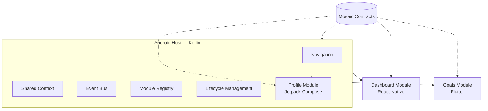

# Mosaic

**A Multi-Framework Mobile Architecture**

Mosaic is an engineering project exploring how different mobile technologies can coexist within a single application through a modular, host-driven architecture.

The project brings together native Android, React Native, and Flutter, focusing on interoperability, modularity, lifecycle management, and independent module evolution.

Rather than simply combining multiple frameworks, Mosaic explores the architectural challenges behind integrating them into a cohesive mobile application.

## Architecture Overview

Mosaic follows a multi-repository architecture where each module has its own implementation, dependencies, and development lifecycle.

The Android Host acts as the central integration layer, coordinating navigation, shared context, communication, and runtime management.

### Modules

| Module | Technology | Responsibility |
|---|---|---|
| Android Host | Kotlin / Android | Application shell, orchestration, navigation, and runtime integration |
| Profile | Kotlin / Jetpack Compose | Native profile functionality, integrated into the Android Host |
| Dashboard | React Native / TypeScript | Dashboard functionality |
| Goals | Flutter / Dart | Goals management functionality |

The Profile module is part of the Android Host repository, not a separate repository.

## Repositories

The project is organized into independent repositories:

| Repository | Description |
|---|---|
| [mosaic-android-host](https://github.com/BernardoLS/mosaic-android-host) | Android Host and native Profile module |
| [mosaic-react-native-dashboard](https://github.com/BernardoLS/mosaic-react-native-dashboard) | React Native Dashboard implementation |
| [mosaic-flutter-goals](https://github.com/BernardoLS/mosaic-flutter-goals) | Flutter Goals implementation |
| [mosaic-contracts](https://github.com/BernardoLS/mosaic-contracts) | Shared contracts, schemas, and architectural specifications |

## Architectural Principles

Mosaic is built around a set of architectural principles:

- **Modularity:** Each module has clear boundaries and responsibilities.
- **Technology independence:** Modules can use different frameworks without exposing implementation details.
- **Host-mediated integration:** Cross-module communication and orchestration are coordinated by the Host.
- **Module autonomy:** Each module owns its domain logic, state, and persistence.
- **Contract-driven communication:** Integration relies on explicit and versioned contracts.
- **Independent evolution:** Modules are designed to evolve with their own development and delivery lifecycle.

## Technology Stack

| Area | Technology |
|---|---|
| Native Android | Kotlin |
| Native UI | Jetpack Compose |
| Cross-platform UI | React Native |
| Cross-platform UI | Flutter |
| Contracts | JSON Schema |
| Architecture Documentation | ADRs and Markdown |
| Version Control | Git |

## Documentation

The project documentation is organized around the following topics:

- [Architecture Overview](docs/architecture/overview.md)
- [Architecture Diagram](docs/architecture/architecture-diagram.md)
- [Getting Started](docs/getting-started.md)
- [Project Scope](docs/project-scope.md)
- [Roadmap](docs/roadmap.md)

For detailed architectural decisions and machine-readable integration contracts, see the [Mosaic Contracts](https://github.com/BernardoLS/mosaic-contracts) repository.

## Project Status

Mosaic is currently in its architectural foundation and documentation phase.

The initial architecture and integration contracts have been defined and documented, covering:

- Multi-repository architecture
- Module manifest
- Navigation contract
- Event communication
- Shared context
- Error handling
- Versioning and compatibility
- Architecture review

The next stage focuses on establishing the Android Host foundation and progressively integrating the different runtimes.

## Goals

The project aims to explore and demonstrate:

- Integrating multiple mobile frameworks in a single application.
- Designing a reliable module registration and lifecycle system.
- Establishing communication across technology boundaries.
- Managing compatibility between independently evolving modules.
- Evaluating runtime integration, performance, and developer experience.
- Applying software architecture principles to a realistic mobile engineering scenario.

## About

Mosaic is an independent engineering project created to explore mobile architecture, interoperability, and the challenges of building modular applications with multiple frameworks.

The project is developed iteratively, with architectural decisions, implementation challenges, and technical findings documented throughout its evolution.

---

**Mosaic — Different frameworks. One cohesive mobile architecture.**
