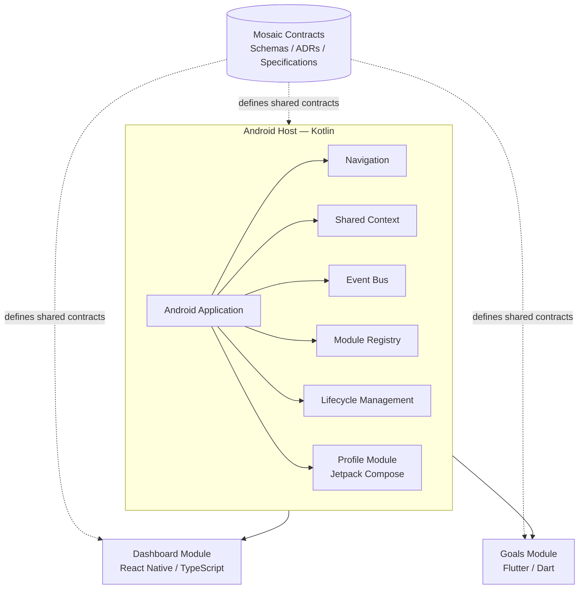
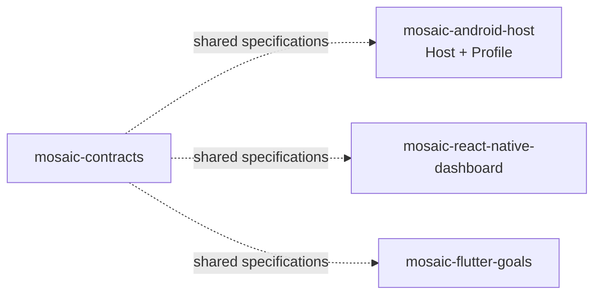

# Architecture Diagram

This document presents a high-level view of Mosaic's architecture and repository boundaries.

## System Context

The Android Host is the application integration layer. It coordinates the native and cross-platform modules, while the contracts repository defines shared integration specifications.

## Repository Boundaries

## Communication Model

The Host mediates cross-module integration. Modules use explicit contracts rather than calling one another's internal APIs directly.

The architectural communication capabilities include navigation requests handled by the Host, shared context distributed by the Host, events delivered through Host-managed infrastructure, standardized error envelopes, and compatibility checks before module initialization.

These diagrams describe intended architectural boundaries. They do not imply that every runtime adapter or communication flow has already been implemented.

## Related Documentation

- [Architecture Overview](overview.md)
- [Mosaic Contracts](https://github.com/YOUR_USERNAME/mosaic-contracts)
